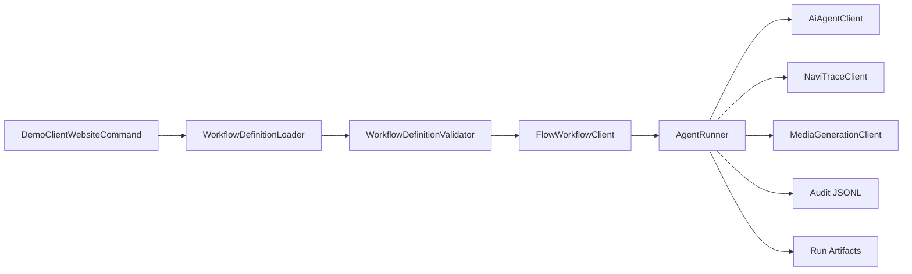

# NoLife Agency Architecture

NoLife uses ports and adapters to keep orchestration and governance decoupled from vendor/runtime specifics.

Core ports:

- `App\Integration\Ai\AiAgentClient`
- `App\Integration\Flow\FlowWorkflowClient`
- `App\Integration\Navi\NaviTraceClient`
- `App\Integration\Media\MediaGenerationClient`

`AgentRunner` is the single execution and governance boundary. Adapters provide capabilities, but they do not enforce policy.

Paperclip is modeled as an organizational concept. Hermes is modeled as a specialization concept. Neither is coupled as a runtime service.
