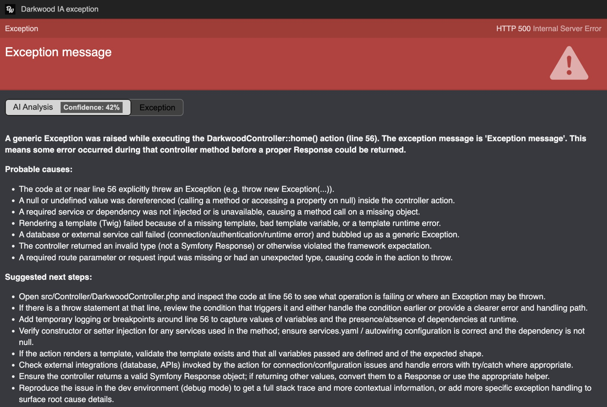

# Darkwood IaExceptionBundle



Augments HTTP 500 errors with AI-based exception analysis using [Symfony AI](https://symfony.com/doc/current/ai/bundles/ai-bundle.html). Instead of a raw stack trace, you get a clear explanation, probable causes, and suggested fixes—generated by an LLM.

## Requirements

- PHP 8.5+
- Symfony 8.x
- [symfony/ai-bundle](https://packagist.org/packages/symfony/ai-bundle) (with a configured platform and agent)

## Installation

```bash
composer require darkwood/ia-exception-bundle
```

Register the bundle in `config/bundles.php` (if not auto-registered):

```php
return [
    // ...
    Darkwood\IaExceptionBundle\DarkwoodIaExceptionBundle::class => ['all' => true],
];
```

Configure [Symfony AI](https://symfony.com/doc/current/ai/bundles/ai-bundle.html) (e.g. OpenAI):

```yaml
# config/packages/ai.yaml
ai:
  platform:
    openai:
      api_key: '%env(OPENAI_API_KEY)%'
  agent:
    default:
      model: 'gpt-4o-mini'
```

## Configuration

```yaml
# config/packages/darkwood_ia_exception.yaml
darkwood_ia_exception:
  enabled: true                  # Opt-in; set true only when appropriate
  only_status_codes: [500]       # HTTP codes to augment
  agent: 'ai.agent.default'      # AI agent service ID
  timeout_ms: 800                # Target timeout (enforce via AI platform http_client)
  cache_ttl: 600                 # Cache TTL in seconds (0 = disabled)
  cache: 'cache.app'             # PSR-6 cache service
  include_trace: false           # Dev only; never true in production
  async: true                    # Show a button and analyze only on request
  async_route_prefix: '__ai_exception'
  async_context_ttl: 300        # Seconds to keep exception context for async (min 60)
```

### AI analysis on request

Symfony renders the HTML error page. With both `kernel.debug` and `enabled` active, `async: true` adds a button that submits a POST to the bundle. The button needs no inline JavaScript or CSS. Symfony's renderer remains responsible for the error page's CSP nonces. If the app uses strict CSP, configure the renderer's nonces and allow same-origin forms.

Import the route loader in `config/routes.yaml`:

```yaml
darkwood_ia_exception:
  resource: '@DarkwoodIaExceptionBundle/Resources/config/routes.yaml'
```

Set `async: false` to explicitly run analysis while the debug response is rendered. With debug disabled, Symfony renders its standard errors and the analysis endpoint is absent.

### Enforcing Timeout

To enforce the timeout at the HTTP level, configure a scoped HTTP client for your AI platform:

```yaml
# config/packages/ai.yaml
framework:
  http_client:
    scoped_clients:
      ai.timeout_client:
        base_uri: 'https://api.openai.com'
        timeout: 0.8  # 800ms

ai:
  platform:
    openai:
      api_key: '%env(OPENAI_API_KEY)%'
      http_client: 'ai.timeout_client'
```

## Output Formats

### JSON (`Accept: application/json`)

Returns a structured JSON response:

```json
{
  "error_id": "a1b2c3d4e5f6g7h8",
  "english_exception": "The database connection failed or a required table is missing.",
  "probable_causes": [
    "MySQL server is down or unreachable",
    "Database credentials are incorrect",
    "The specified database or table does not exist"
  ],
  "suggested_fixes": [
    "Verify the database server is running",
    "Check DB_HOST, DB_USER, DB_PASS, and DB_NAME in .env",
    "Run migrations if the schema is out of date"
  ],
  "confidence": 0.85
}
```

### HTML diagnostics

The optional panel shows an explanation, probable causes and suggested fixes. The synchronous renderer leaves JSON errors to Symfony. The on-demand endpoint can return JSON to clients that request it.

## Security and reliability

The AI receives the exception class, line number and optional stack frame names. Exception messages, full filesystem paths, stack arguments, headers and request payloads stay out of that context. The native debug page can contain sensitive information and should remain on private development environments. The analysis endpoint is enabled only in debug mode and its responses are not cacheable by clients.

A renderer, cache or provider failure leaves Symfony's regular error handling available. The error page preserves the original status and HTTP headers. Successful analyses are cached by diagnostic fingerprint for the configured TTL.

## License

[MIT](LICENSE.md) - Mathieu Ledru 2026
